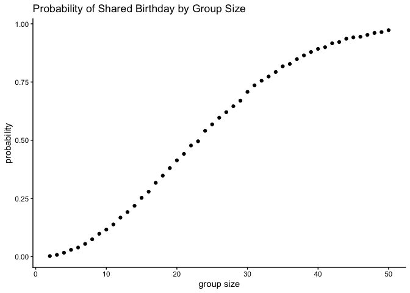
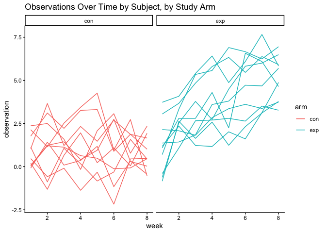
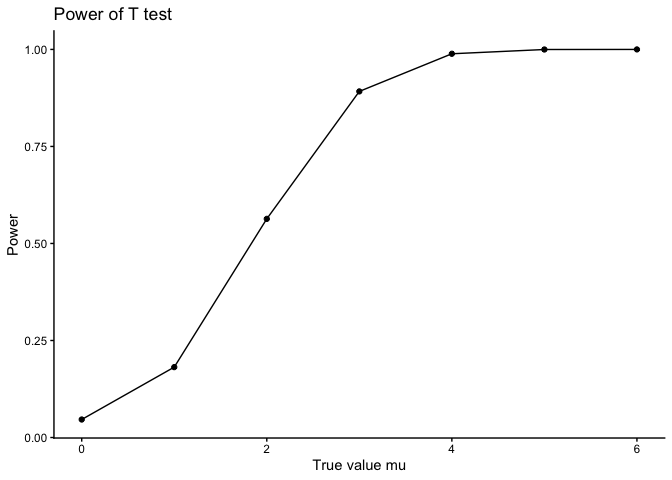
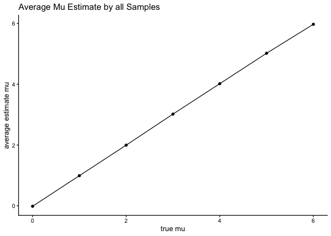
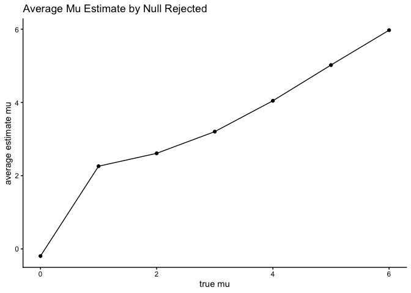

p8105_hw5_sc6036
================
2026-11-16

``` r
library(tidyverse)
```

    ## ── Attaching core tidyverse packages ──────────────────────── tidyverse 2.0.0 ──
    ## ✔ dplyr     1.2.1     ✔ readr     2.2.0
    ## ✔ forcats   1.0.1     ✔ stringr   1.6.0
    ## ✔ ggplot2   4.0.3     ✔ tibble    3.3.1
    ## ✔ lubridate 1.9.5     ✔ tidyr     1.3.2
    ## ✔ purrr     1.2.2     
    ## ── Conflicts ────────────────────────────────────────── tidyverse_conflicts() ──
    ## ✖ dplyr::filter() masks stats::filter()
    ## ✖ dplyr::lag()    masks stats::lag()
    ## ℹ Use the conflicted package (<http://conflicted.r-lib.org/>) to force all conflicts to become errors

``` r
set.seed(1)
```

# Question 1

``` r
bday_sim = function(n) {
  birthdays = sample(1:365, size = n, replace = T)
  if (n_distinct(birthdays) < n) {
    T
  } else {
    F
  }
}
bday_sim(2)
```

    ## [1] FALSE

``` r
bday_sim(50)
```

    ## [1] TRUE

``` r
sim_results_df =
  expand_grid(
    group_size = 2:50,
    iter = 1:10000
  ) |>
  mutate(
    shared_bday = map(group_size, bday_sim)
  ) |>
  unnest(shared_bday)

head(sim_results_df)
```

    ## # A tibble: 6 × 3
    ##   group_size  iter shared_bday
    ##        <int> <int> <lgl>      
    ## 1          2     1 FALSE      
    ## 2          2     2 FALSE      
    ## 3          2     3 FALSE      
    ## 4          2     4 FALSE      
    ## 5          2     5 FALSE      
    ## 6          2     6 FALSE

``` r
sim_summary = 
  sim_results_df |> 
  group_by(group_size) |> 
  summarize(prob_shared = mean(shared_bday))

head(sim_summary)
```

    ## # A tibble: 6 × 2
    ##   group_size prob_shared
    ##        <int>       <dbl>
    ## 1          2      0.0024
    ## 2          3      0.0076
    ## 3          4      0.0168
    ## 4          5      0.0292
    ## 5          6      0.0391
    ## 6          7      0.0547

``` r
sim_summary |> 
  ggplot(aes(group_size, prob_shared)) +
  geom_point() +
  labs(title = "Probability of Shared Birthday by Group Size",
       x = "group size",
       y = "probability") +
  theme_classic()
```

<!-- --> The
probability intitially near 0, but rises quickly at first as the group
size increases. it levels off near 1 as the group size increases and
passes 50% at just under 25 people.

# Question 2

``` r
all_df = 
  tibble(files = list.files("data/"),
         path = str_c("data/", files)
  )

all_df =
  all_df |>
  mutate(data = map(path, read_csv)) |>
  unnest(cols = "data")
```

    ## Rows: 1 Columns: 8
    ## ── Column specification ────────────────────────────────────────────────────────
    ## Delimiter: ","
    ## dbl (8): week_1, week_2, week_3, week_4, week_5, week_6, week_7, week_8
    ## 
    ## ℹ Use `spec()` to retrieve the full column specification for this data.
    ## ℹ Specify the column types or set `show_col_types = FALSE` to quiet this message.
    ## Rows: 1 Columns: 8
    ## ── Column specification ────────────────────────────────────────────────────────
    ## Delimiter: ","
    ## dbl (8): week_1, week_2, week_3, week_4, week_5, week_6, week_7, week_8
    ## 
    ## ℹ Use `spec()` to retrieve the full column specification for this data.
    ## ℹ Specify the column types or set `show_col_types = FALSE` to quiet this message.
    ## Rows: 1 Columns: 8
    ## ── Column specification ────────────────────────────────────────────────────────
    ## Delimiter: ","
    ## dbl (8): week_1, week_2, week_3, week_4, week_5, week_6, week_7, week_8
    ## 
    ## ℹ Use `spec()` to retrieve the full column specification for this data.
    ## ℹ Specify the column types or set `show_col_types = FALSE` to quiet this message.
    ## Rows: 1 Columns: 8
    ## ── Column specification ────────────────────────────────────────────────────────
    ## Delimiter: ","
    ## dbl (8): week_1, week_2, week_3, week_4, week_5, week_6, week_7, week_8
    ## 
    ## ℹ Use `spec()` to retrieve the full column specification for this data.
    ## ℹ Specify the column types or set `show_col_types = FALSE` to quiet this message.
    ## Rows: 1 Columns: 8
    ## ── Column specification ────────────────────────────────────────────────────────
    ## Delimiter: ","
    ## dbl (8): week_1, week_2, week_3, week_4, week_5, week_6, week_7, week_8
    ## 
    ## ℹ Use `spec()` to retrieve the full column specification for this data.
    ## ℹ Specify the column types or set `show_col_types = FALSE` to quiet this message.
    ## Rows: 1 Columns: 8
    ## ── Column specification ────────────────────────────────────────────────────────
    ## Delimiter: ","
    ## dbl (8): week_1, week_2, week_3, week_4, week_5, week_6, week_7, week_8
    ## 
    ## ℹ Use `spec()` to retrieve the full column specification for this data.
    ## ℹ Specify the column types or set `show_col_types = FALSE` to quiet this message.
    ## Rows: 1 Columns: 8
    ## ── Column specification ────────────────────────────────────────────────────────
    ## Delimiter: ","
    ## dbl (8): week_1, week_2, week_3, week_4, week_5, week_6, week_7, week_8
    ## 
    ## ℹ Use `spec()` to retrieve the full column specification for this data.
    ## ℹ Specify the column types or set `show_col_types = FALSE` to quiet this message.
    ## Rows: 1 Columns: 8
    ## ── Column specification ────────────────────────────────────────────────────────
    ## Delimiter: ","
    ## dbl (8): week_1, week_2, week_3, week_4, week_5, week_6, week_7, week_8
    ## 
    ## ℹ Use `spec()` to retrieve the full column specification for this data.
    ## ℹ Specify the column types or set `show_col_types = FALSE` to quiet this message.
    ## Rows: 1 Columns: 8
    ## ── Column specification ────────────────────────────────────────────────────────
    ## Delimiter: ","
    ## dbl (8): week_1, week_2, week_3, week_4, week_5, week_6, week_7, week_8
    ## 
    ## ℹ Use `spec()` to retrieve the full column specification for this data.
    ## ℹ Specify the column types or set `show_col_types = FALSE` to quiet this message.
    ## Rows: 1 Columns: 8
    ## ── Column specification ────────────────────────────────────────────────────────
    ## Delimiter: ","
    ## dbl (8): week_1, week_2, week_3, week_4, week_5, week_6, week_7, week_8
    ## 
    ## ℹ Use `spec()` to retrieve the full column specification for this data.
    ## ℹ Specify the column types or set `show_col_types = FALSE` to quiet this message.
    ## Rows: 1 Columns: 8
    ## ── Column specification ────────────────────────────────────────────────────────
    ## Delimiter: ","
    ## dbl (8): week_1, week_2, week_3, week_4, week_5, week_6, week_7, week_8
    ## 
    ## ℹ Use `spec()` to retrieve the full column specification for this data.
    ## ℹ Specify the column types or set `show_col_types = FALSE` to quiet this message.
    ## Rows: 1 Columns: 8
    ## ── Column specification ────────────────────────────────────────────────────────
    ## Delimiter: ","
    ## dbl (8): week_1, week_2, week_3, week_4, week_5, week_6, week_7, week_8
    ## 
    ## ℹ Use `spec()` to retrieve the full column specification for this data.
    ## ℹ Specify the column types or set `show_col_types = FALSE` to quiet this message.
    ## Rows: 1 Columns: 8
    ## ── Column specification ────────────────────────────────────────────────────────
    ## Delimiter: ","
    ## dbl (8): week_1, week_2, week_3, week_4, week_5, week_6, week_7, week_8
    ## 
    ## ℹ Use `spec()` to retrieve the full column specification for this data.
    ## ℹ Specify the column types or set `show_col_types = FALSE` to quiet this message.
    ## Rows: 1 Columns: 8
    ## ── Column specification ────────────────────────────────────────────────────────
    ## Delimiter: ","
    ## dbl (8): week_1, week_2, week_3, week_4, week_5, week_6, week_7, week_8
    ## 
    ## ℹ Use `spec()` to retrieve the full column specification for this data.
    ## ℹ Specify the column types or set `show_col_types = FALSE` to quiet this message.
    ## Rows: 1 Columns: 8
    ## ── Column specification ────────────────────────────────────────────────────────
    ## Delimiter: ","
    ## dbl (8): week_1, week_2, week_3, week_4, week_5, week_6, week_7, week_8
    ## 
    ## ℹ Use `spec()` to retrieve the full column specification for this data.
    ## ℹ Specify the column types or set `show_col_types = FALSE` to quiet this message.
    ## Rows: 1 Columns: 8
    ## ── Column specification ────────────────────────────────────────────────────────
    ## Delimiter: ","
    ## dbl (8): week_1, week_2, week_3, week_4, week_5, week_6, week_7, week_8
    ## 
    ## ℹ Use `spec()` to retrieve the full column specification for this data.
    ## ℹ Specify the column types or set `show_col_types = FALSE` to quiet this message.
    ## Rows: 1 Columns: 8
    ## ── Column specification ────────────────────────────────────────────────────────
    ## Delimiter: ","
    ## dbl (8): week_1, week_2, week_3, week_4, week_5, week_6, week_7, week_8
    ## 
    ## ℹ Use `spec()` to retrieve the full column specification for this data.
    ## ℹ Specify the column types or set `show_col_types = FALSE` to quiet this message.
    ## Rows: 1 Columns: 8
    ## ── Column specification ────────────────────────────────────────────────────────
    ## Delimiter: ","
    ## dbl (8): week_1, week_2, week_3, week_4, week_5, week_6, week_7, week_8
    ## 
    ## ℹ Use `spec()` to retrieve the full column specification for this data.
    ## ℹ Specify the column types or set `show_col_types = FALSE` to quiet this message.
    ## Rows: 1 Columns: 8
    ## ── Column specification ────────────────────────────────────────────────────────
    ## Delimiter: ","
    ## dbl (8): week_1, week_2, week_3, week_4, week_5, week_6, week_7, week_8
    ## 
    ## ℹ Use `spec()` to retrieve the full column specification for this data.
    ## ℹ Specify the column types or set `show_col_types = FALSE` to quiet this message.
    ## Rows: 1 Columns: 8
    ## ── Column specification ────────────────────────────────────────────────────────
    ## Delimiter: ","
    ## dbl (8): week_1, week_2, week_3, week_4, week_5, week_6, week_7, week_8
    ## 
    ## ℹ Use `spec()` to retrieve the full column specification for this data.
    ## ℹ Specify the column types or set `show_col_types = FALSE` to quiet this message.

``` r
tidy_df = 
  all_df |> 
  mutate(
    files = str_replace(files, ".csv", ""), 
    arm = str_sub(files, 1, 3),
    subj_id = str_sub(files, 5, 6)
  ) |> 
  pivot_longer(
    week_1:week_8,
    names_to = "week",
    values_to = "observation",
    names_prefix = "week_"
  ) |> 
  mutate(week = as.numeric(week)) |> 
  select(id = files, arm, subj_id, week, observation)

head(tidy_df)
```

    ## # A tibble: 6 × 5
    ##   id     arm   subj_id  week observation
    ##   <chr>  <chr> <chr>   <dbl>       <dbl>
    ## 1 con_01 con   01          1        0.2 
    ## 2 con_01 con   01          2       -1.31
    ## 3 con_01 con   01          3        0.66
    ## 4 con_01 con   01          4        1.96
    ## 5 con_01 con   01          5        0.23
    ## 6 con_01 con   01          6        1.09

``` r
tidy_df |>
  ggplot(aes(x = week, y = observation, group = id, color = arm)) +
  geom_line() +
  facet_grid(~arm) +
  labs(
    title = "Observations Over Time by Subject, by Study Arm",
    x = "week",
    y = "observation",
    color = "arm"
  ) +
  theme_classic()
```

<!-- --> The
control arm shows no trends, but the experimental arm seems to have an
upwards trend with the lines between 3.5 and 7 by week 8.

## Question 3

``` r
sim_t_test = function(mu, n = 30, sigma = 5) {
  x = rnorm(n, mean = mu, sd = sigma)
  t.test(x, mu = 0) |> 
    broom::tidy() |> 
    select(mu_hat = estimate, p_value = p.value)
}
```

``` r
sim_results_df = 
  expand_grid(
    true_mu = 0:6,
    iter = 1:5000
  ) |> 
  mutate(
    estimate_df = map(true_mu, sim_t_test)
  ) |> 
  unnest(estimate_df)
```

``` r
power_df =
  sim_results_df |>
  mutate(reject = p_value < 0.05) |>
  group_by(true_mu) |>
  summarise(power = mean(reject))

power_df |>
  ggplot(aes(x = true_mu, y = power)) +
  geom_point() +
  geom_line() +
  labs(
    title = "Power of T test",
    x = "True value mu",
    y = "Power"
  ) +
  theme_classic()
```

<!-- -->

``` r
avg_all_df = 
  sim_results_df |> 
  group_by(true_mu) |> 
  summarise(avg_mu_hat = mean(mu_hat))

avg_reject_df = 
  sim_results_df |> 
  filter(p_value < 0.05) |> 
  group_by(true_mu) |> 
  summarise(avg_mu_hat = mean(mu_hat))
```

``` r
avg_all_df |>
  ggplot(aes(x = true_mu, y = avg_mu_hat)) +
  geom_point() +
  geom_line() +
  labs(title = "Average Mu Estimate by all Samples",
       x = "true mu",
       y = "average estimate mu"
  ) +
  theme_classic()
```

<!-- -->

``` r
avg_reject_df |>
  ggplot(aes(x = true_mu, y = avg_mu_hat)) +
  geom_point() +
  geom_line() +
  labs(title = "Average Mu Estimate by Null Rejected",
       x = "true mu",
       y = "average estimate mu"
  ) +
  theme_classic()
```

<!-- -->

At mu = 0, the null is true so the power is the false rejection rate. As
mu grows, the power rises slowly at first, and then quickly approaches 1
as mu increases. Larger effect size means higher power. The average
estimate is close to the true mu for each value because of unbiasedness.
With a small mu, the power is low so the average will give a number
above the truth. A large mu gives an average close to the rruth, and the
rejected samples are almost all of the samples. With mu = 0, the
rejected samples are large positive and large negative estimates, and
the average is near 0. This is due to low power leading to overestimates
on effects
